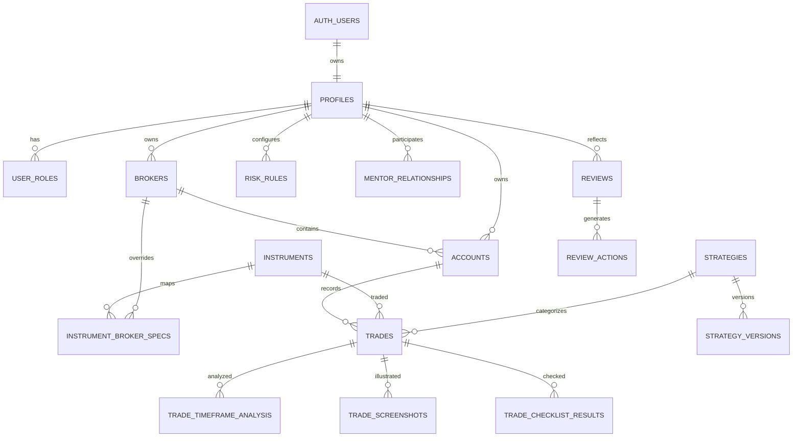

# Trading ERP architecture

## Topology
- Frontend: React + TypeScript + Vite, deployed to Vercel.
- Data/auth: Supabase Auth + PostgreSQL + RLS + Realtime + private Storage.
- Privileged workflows: Supabase Edge Functions using server-side secrets.
- Scheduled work: pg_cron invoking protected Edge Functions.
- Client config: only `VITE_SUPABASE_URL` and `VITE_SUPABASE_PUBLISHABLE_KEY`.

## Multi-tenant access model
Every trader-owned row includes `user_id`. Traders own their brokers and accounts. Mentors are read-only and see a trader only through an active `mentor_relationships` grant. A trader can request a mentor relationship; either party can initiate an invitation/request. Admins can approve registrations and administer platform access.

## Registration
Supabase Auth sign-up creates a `profiles` row with `approval_status='pending'` and a default trader role. The UI must gate all product operations until approval. Admin approval is performed through the `approve-user` Edge Function. Never grant admin role from browser input.

## Data domains
Identity/access; brokers/accounts/capital; instrument master; trades/timeframe analysis/screenshots; strategies/checklists; planning/watchlists/alerts; reviews/psychology/goals; risk rules/violations; journal/documents; notifications/audit/import staging.

## ERD (logical)

## Financial calculation rules
Position sizing uses the selected broker/account instrument specification and account-currency conversion. For quote-driven instruments, the adapter calculates monetary loss per volume unit from tick distance, tick value and conversion rate. The frontend helper in `src/lib/finance.ts` is a generic tick-based calculation; each asset/platform must supply correct verified spec inputs. Do not use default values as verified contract facts.
